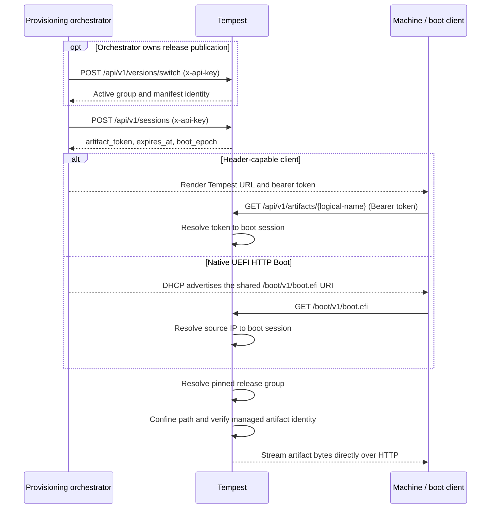

<!-- SPDX-FileCopyrightText: 2026 PhonePe India Pvt. Ltd. -->
<!-- SPDX-License-Identifier: Apache-2.0 -->

# Provisioning Orchestrator to Tempest: Direct and Native HTTP Boot

This guide describes two direct data paths. A provisioning orchestrator selects
and authorizes a boot attempt, while Tempest streams the selected artifact
directly to the machine. Header-capable clients use a short-lived bearer token;
native UEFI HTTP Boot firmware uses one fixed, source-IP-authorized URI. The
orchestrator does not proxy or buffer artifact bytes.

## Architecture



The orchestrator is the control plane. Tempest is the artifact data plane. The
HTTP artifact route does not require the orchestrator to remain in the transfer
path after it has rendered the machine template.

## Capability Mapping

| Orchestrator value | Tempest value | Effect |
| --- | --- | --- |
| Image/template family | `boot_profile` | Selects an independent release namespace |
| Release/build | `group_id` | Identifies one immutable artifact manifest |
| Machine address | `client_ip` | Keys the Tempest boot-session record |
| Machine MAC | `client_mac` | Inventory and audit metadata; not HTTP authentication |
| Machine serial | `serial` | Optional inventory and audit metadata |
| Provisioning attempt ID | `trace_id` | Correlates orchestrator and Tempest logs |
| Session response token | `artifact_token` | Authorizes bearer-mode HTTP downloads; native firmware does not receive it |

For the general artifact route, the bearer token resolves the request to the
registered session and requires the resolved HTTP client address to match
`client_ip`. For the native route, Tempest deliberately resolves
the connection source address to `client_ip`, because firmware cannot be
assumed to add an authorization header. Registering the same `client_ip` again
replaces that session and rotates its token, so both modes should use the
machine's unique provisioning address.

Both modes resolve artifacts in the session-pinned release group, not arbitrary
files below `server.root`. The native route is stricter: it exposes only the
configured logical name and only when that name is a managed release member.

## 1. Expose Tempest's HTTP listener to the machines

The artifact route is served on the `[api]` listener. With the default
`bind = "127.0.0.1"`, machines cannot download directly from Tempest.

On an isolated provisioning network, bind the listener to the Tempest address:

```toml
[server]
root = "/tftpboot"
max_concurrent_transfers = 9000
max_boot_sessions = 100000

[api]
bind = "192.0.2.10"
port = 18080
enable_versions_api = true
enable_metrics = true
metrics_require_api_key = true
enable_audit_api = false
enable_native_http_boot = false
native_http_boot_filename = "boot.efi"
api_key = "env:TEMPEST_API_KEY"
```

The bearer-mode artifact base URL is:

```text
http://192.0.2.10:18080/api/v1/artifacts
```

When native HTTP Boot is enabled, its fixed URL is:

```text
http://192.0.2.10:18080/boot/v1/boot.efi
```

If the provisioning network is not fully trusted, keep Tempest on loopback and
expose bearer artifact downloads through a TLS reverse proxy. Machines then use
the proxy's HTTPS artifact URL. Configure `api.trusted_proxy_ips` to trust that proxy's
single overwritten `X-Forwarded-For` value, preserving the bearer session's
source binding. The [HTTPS artifact deployment](../../deploy/container/https/README.md)
provides this configuration and private-CA iPXE trust guidance on unprivileged
port 8443. Use an explicit port in its artifact base URL, for example
`https://boot.example.net:8443/api/v1/artifacts`; port 443 requires a separately
managed host TLS boundary, not additional container privileges. The example publishes
only session-authenticated bearer artifact routes while leaving control and
native HTTP Boot private. The orchestrator needs a separate protected control
connection.

The Tempest API key protects control routes such as session registration and
release activation. It must remain in the orchestrator's secret store and must
never appear in a machine template. The general artifact route uses the
short-lived bearer token instead of the API key. The native route uses neither:
it authorizes the source address against an active session and is therefore
suitable only for a controlled provisioning network.

The examples below use two variables. `TEMPEST_CONTROL_URL` is the protected
control origin, and `TEMPEST_ARTIFACT_URL` is the origin that machines use for
downloads (the same origin unless a TLS proxy is in front). Neither includes a
path:

```bash
export TEMPEST_CONTROL_URL=http://192.0.2.10:18080
export TEMPEST_ARTIFACT_URL=http://192.0.2.10:18080   # or https://boot.example.net:8443
```

## 2. Publish or select the release

If the orchestrator owns release publication, it activates the files once per
release, not once per machine:

```bash
curl --fail-with-body \
  -X POST "$TEMPEST_CONTROL_URL/api/v1/versions/switch" \
  -H "x-api-key: $TEMPEST_API_KEY" \
  -H 'content-type: application/json' \
  -d '{
    "boot_profile": "ubuntu-24.04-compute",
    "group_id": "ubuntu-24.04-2026.08.03",
    "cutover_policy": "preserve_sessions",
    "drain_timeout_ms": 30000,
    "files": [
      {
        "name": "images/os.squashfs",
        "path": "/tftpboot/releases/ubuntu-24.04-2026.08.03/os.squashfs"
      }
    ]
  }'
```

The `name` is the logical name used in the later HTTP URL. The file must be a
regular file confined beneath `server.root`. Tempest records the managed file's
size and SHA-256 identity as part of the release manifest.

`preserve_sessions` keeps existing machines pinned to their current group while
newly registered machines use the new active group. If another deployment
service owns release activation, the orchestrator only needs a mapping from its
template ID to an already-active `boot_profile`.

`POST /api/v1/versions/switch` exists only when
`api.enable_versions_api = true`. Session registration and artifact delivery do
not depend on the release mutation API being exposed, provided the release state
already exists or was restored through persistence.

## 3. Register the machine immediately before boot

After the orchestrator assigns the final machine IP and selects the image, it
registers a new boot attempt:

```bash
curl --fail-with-body \
  -X POST "$TEMPEST_CONTROL_URL/api/v1/sessions" \
  -H "x-api-key: $TEMPEST_API_KEY" \
  -H 'content-type: application/json' \
  -d '{
    "client_ip": "192.0.2.42",
    "client_mac": "02:00:00:00:00:42",
    "serial": "node-42",
    "trace_id": "prov-8f92c31",
    "boot_profile": "ubuntu-24.04-compute",
    "ttl_seconds": 900,
    "new_epoch": true
  }'
```

Tempest returns HTTP 201:

```json
{
  "artifact_token": "<64-character opaque token>",
  "expires_at": "2026-08-03T10:30:00Z",
  "boot_epoch": 7
}
```

The token is shown once. Tempest stores only its SHA-256 digest. The session TTL
defaults to 600 seconds and is capped at 3600 seconds.

Use `new_epoch: true` for a new provisioning or reimage attempt. A registration
always rotates the token. `new_epoch: false` may preserve the previous release
pin for a retry using the same profile, but the orchestrator must still replace
the token in the rendered template or boot state.

## 4A. Render a bearer-mode template

The orchestrator puts the Tempest artifact URL and session bearer token into
the boot client's request configuration. The following is a conceptual
template; map it to the syntax supported by the actual provisioning system and
boot client:

```yaml
machine:
  ip: 192.0.2.42
  mac: "02:00:00:00:00:42"

artifact:
  url: "https://tempest.example.net/api/v1/artifacts/images/os.squashfs"
  request_headers:
    Authorization: "Bearer {{ tempest_artifact_token }}"
```

The API key is never sent to the machine. Do not put the bearer token in the URL
query string: Tempest does not accept query-string tokens, and URLs are commonly
recorded in access logs.

Bearer delivery requires the machine's HTTP client or boot loader to set an
`Authorization` header. Keep this mode for iPXE, installers, agents, and other
header-capable clients.

## 4B. Advertise one native UEFI HTTP Boot URI

Native UEFI firmware generally receives a boot-file URL from DHCP and cannot be
assumed to attach custom headers. Enable the native route only when that client
population needs it:

```toml
[api]
enable_native_http_boot = true
native_http_boot_filename = "boot.efi"
```

Publish `boot.efi` as a logical member of every boot profile that may use native
HTTP Boot. The physical file can differ by profile and release; the URI remains
the same. [CoreDHCP's `nbp` plugin](https://pkg.go.dev/github.com/coredhcp/coredhcp/plugins/nbp)
can advertise that one URI to all matching UEFI HTTP Boot clients:

```yaml
server4:
  plugins:
    - nbp: http://192.0.2.10:18080/boot/v1/boot.efi
```

The provisioning service must register the machine's final source IP and
selected `boot_profile` before firmware sends the GET. Tempest uses that
session—not a machine-specific URI—to choose the release:

```text
same URI + source IP 192.0.2.42 -> ubuntu-24.04-compute session -> that profile's boot.efi
same URI + source IP 192.0.2.43 -> rhel-9-compute session        -> that profile's boot.efi
```

This removes per-machine URL generation from CoreDHCP. CoreDHCP only
classifies firmware and returns the stable URI; the provisioning orchestrator
remains the source of truth for machine-to-profile assignment. If requests pass
through an HTTP proxy, list only that proxy's direct address in
`api.trusted_proxy_ips` and configure it to discard inbound forwarding headers
and set exactly one `X-Forwarded-For` value. Do not enable this mode behind
shared NAT where distinct machines cannot retain distinct source identities.

## 5. Machine downloads directly from Tempest

The machine performs the equivalent request:

```http
GET /api/v1/artifacts/images/os.squashfs HTTP/1.1
Host: tempest.example.net
Authorization: Bearer <artifact_token>
```

For an operator smoke test:

```bash
curl --fail-with-body \
  -H "Authorization: Bearer $TEMPEST_ARTIFACT_TOKEN" \
  -o /var/tmp/os.squashfs \
  "$TEMPEST_ARTIFACT_URL/api/v1/artifacts/images/os.squashfs"
```

For native mode, run the smoke test from the registered client address (or its
trusted proxy path), without an API key or bearer header:

```bash
curl --fail-with-body \
  -o /var/tmp/boot.efi \
  http://192.0.2.10:18080/boot/v1/boot.efi
```

Tempest then:

1. resolves an unexpired session from either the bearer token or, for native
   mode, the request source IP;
2. resolves the logical name only inside the session-pinned release group;
3. confines the resolved path beneath `server.root`;
4. opens and verifies the managed artifact identity;
5. rejects draining, quarantined, missing, or over-capacity transfers; and
6. streams the file directly with `Content-Length` and identity headers.

Useful response headers include:

- `x-tempest-boot-profile`
- `x-tempest-group-id`
- `x-tempest-manifest-digest`
- `x-tempest-content-sha256`
- `x-tempest-transport: HTTP` or `HTTP_NATIVE`
- `x-tempest-http-mode: bearer` or `native`
- `x-tempest-boot-phase`
- `ETag` and `Accept-Ranges: bytes` for managed artifacts

Managed artifacts accept one `Range: bytes=...` request. A matching `If-Range`
ETag returns `206`; a stale validator, multipart request, or unmanaged artifact
returns the complete representation. An unsatisfiable managed range returns
`416` with `Content-Range: bytes */<artifact-length>`.

## 6. Complete, retry, or expire the attempt

The orchestrator should retain the token only until the machine finishes
provisioning or `expires_at` is reached. Starting a later attempt with
`new_epoch: true` replaces the old session and invalidates its token.

If a download receives:

| Status | Meaning | Orchestrator action |
| ---: | --- | --- |
| 401 | Bearer token missing, malformed, rotated, or expired | Register a deliberate retry and render the new token |
| 403 | Native source session missing/expired, or the artifact is unsafe/quarantined | Register the source IP before boot, or investigate integrity state |
| 404 | Logical name is absent from the pinned group, unmanaged in native mode, or not the configured native name | Fix the DHCP/config/template-to-release mapping |
| 416 | The managed artifact cannot satisfy the requested byte range | Retry without `Range`, or fix the client's resume offset |
| 429 | HTTP request rate limit reached | Retry with bounded backoff |
| 503 | Tempest draining, at transfer capacity, or audit unavailable | Pause admission and retry with bounded backoff |

## Configuration Effects on HTTP Delivery

| Configuration | HTTP effect |
| --- | --- |
| `api.bind`, `api.port` | Determines whether machines can reach the artifact route |
| `api.api_key` | Protects orchestrator control calls and, with the default `metrics_require_api_key = true`, `/metrics`; it does not authorize artifact GETs |
| `api.enable_native_http_boot` | Enables the fixed source-IP-authorized route; default is `false` |
| `api.native_http_boot_filename` | The only logical name accepted by the native route |
| `api.trusted_proxy_ips` | Allows a listed direct proxy to supply exactly one forwarded client IP |
| `api.enable_versions_api` | Enables release publication/listing; not required for GET once state exists |
| `server.root` | Capability boundary for every resolved artifact path |
| `server.max_boot_sessions` | Caps registered provisioning sessions |
| `server.max_concurrent_transfers` | Shared admission ceiling for TFTP and HTTP transfers |
| `server.bandwidth_governor_enabled` and `total_bandwidth_bytes_per_second` | Optional aggregate output cap shared by TFTP and HTTP |
| `boot_phases` | Classifies HTTP requests for metrics, audit, and governor weighting |
| `audit.enabled` | Adds transfer audit records and fails closed if its bounded writer is full |
| `persistence.enabled` | Restores release groups, active versions, sessions, token digests, and pins after restart |

TFTP-only tuning such as `listener_shards`, block/window sizes,
`listener_receive_buffer_bytes`, and `transfer_socket_buffer_bytes` does not
speed up HTTP artifact delivery. Tempest currently starts both its TFTP and HTTP
listeners under one runtime; the direct flow above simply does not use TFTP for
the artifact transfer.

For production, enable persistence when sessions and release activation must
survive a Tempest restart or be shared across multiple Tempest nodes.

## Acceptance Test

1. Confirm the machine can reach the configured Tempest artifact URL.
2. Activate a one-file release group for a test `boot_profile`.
3. Register a test machine and capture the returned token without logging it.
4. Fetch the artifact directly from Tempest with the bearer header.
5. Verify HTTP 200, the expected content hash, group ID, and manifest digest.
6. Verify the same URL without the token returns HTTP 401.
7. Verify a logical name absent from the group returns HTTP 404.
8. Rotate the session and verify the previous token returns HTTP 401.
9. Activate a replacement group with `preserve_sessions`; verify the existing
   session remains on its pinned group and a new session receives the new group.

For native mode, additionally:

1. Enable the native route and publish the configured logical name as a managed
   member of two profiles.
2. Register two source IPs against different profiles and fetch the same fixed
   URI from each network identity; verify distinct expected content and group
   headers.
3. Verify an unregistered source returns HTTP 403, a different URI returns 404,
   and a same-named unmanaged root file is never served.
4. If a trusted proxy is used, verify the proxy overwrites spoofed forwarding
   headers and an unlisted direct peer cannot select another client's session.

The maintained wire schemas are in [`docs/openapi.yaml`](../openapi.yaml).
